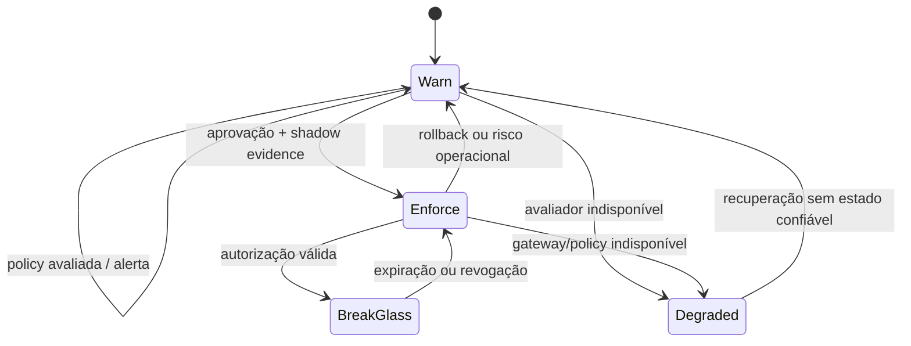

# ADR-004 — Warn, enforce e Break Glass

- **Status:** Proposed
- **Data:** 2026-11-02
- **Issue:** [#10](https://github.com/luanmorenommaciel/oteru/issues/10)
- **Issues relacionadas:** [#23](https://github.com/luanmorenommaciel/oteru/issues/23), [#108](https://github.com/luanmorenommaciel/oteru/issues/108)
- **Decidor:** Vinicius Sena, Captain
- **Revisores:** a definir na #13

## Contexto

Hoje o Oteru observa chamadas depois que elas ocorreram. Não existe ponto de corte no caminho do provedor. A #108 exige spec e revisão de segurança antes de código, shadow mode e autorização explícita antes de bloquear de fato.

A política precisa diferenciar avaliação, alerta, bloqueio e exceção emergencial sem transformar indisponibilidade do Oteru em indisponibilidade silenciosa do produto.

## Decisão proposta

- Toda policy válida inicia em `warn`.
- `enforce` exige mudança explícita, revisão de segurança, evidência de shadow mode e aprovador autorizado.
- Break Glass é um override temporário e escopado; não é um terceiro modo permanente.
- A ausência ou invalidade da policy impede promoção para `enforce`.
- O gateway futuro usa identidade team × project derivada de credencial, nunca de header autodeclarado.

## Máquina de estados

O retorno de `Degraded` para `enforce` exige reconciliação e nova autorização; não é automático.

## Contrato de decisão

Cada avaliação produz:

| Campo | Descrição |
| --- | --- |
| `decision_id` | Identificador imutável |
| `policy_version` | Policy avaliada |
| `mode` | `warn` ou `enforce` |
| `outcome` | `allow`, `warn`, `deny` ou `allow_break_glass` |
| `reason_code` | Código estável, sem dado sensível |
| `subject_scope` | Team/project derivado da credencial |
| `evaluated_at` | Timestamp da decisão |
| `is_stale` | Indica leitura de budget desatualizada |
| `override_id` | Presente somente em Break Glass |

Prompt, corpo e resposta não entram no evento de decisão.

## Fail mode

- Em `warn`, indisponibilidade é fail-open com alerta e `outcome=warn`.
- No gateway previsto pela #108, indisponibilidade também é fail-open, conforme a própria issue, com SLO e alerta da Vigia.
- Falha de autorização, credencial inválida ou tenant desconhecido não é indisponibilidade: a solicitação é recusada sem revelar budget de outros pares.
- `is_stale=true` impede decisões irreversíveis baseadas apenas no valor desatualizado.

## Break Glass

Um override requer:

- identidade autorizada e segregada do executor comum;
- policy que permita a classe de override;
- motivo e referência de incidente/mudança;
- escopo mínimo de team, project, provedor e limite;
- expiração obrigatória, proposta inicialmente em no máximo 60 minutos;
- auditoria de criação, uso, revogação e expiração.

Break Glass nunca desativa logging de decisão, segregação de tenant ou proteção de PII.

## Promoção para enforce

1. Policy validada e versionada.
2. Shadow mode com tráfego representativo e falsos positivos analisados.
3. Benchmark de latência e SLO aprovados.
4. Rollback testado.
5. Revisão de segurança da Sentinela concluída.
6. Custo aprovado pelo Maestro.
7. OK explícito exigido pela #108 registrado no GitHub.

## Alternativas consideradas

### Enforce como default

Rejeitada por não existir ainda ponto de corte, baseline de falsos positivos ou prova de disponibilidade.

### Break Glass permanente

Rejeitada porque elimina a efetividade da policy e dificulta auditoria.

### Fail-closed em qualquer indisponibilidade

Rejeitada para o gateway proposto pela #108, que especifica fail-open. Credenciais inválidas continuam recusadas.

## Observabilidade e segurança

Métricas: decisões por outcome/reason, latência, policies stale, overrides ativos, expirações, bypass direto ao provedor, falhas do avaliador e divergência entre shadow e resultado real.

Logs e métricas não revelam prompt, resposta, chave do provedor, budget de outro tenant ou segredo de autenticação.

## Migração e rollback

Iniciar como biblioteca/serviço de decisão em shadow mode. Introduzir gateway somente após os gates. Rollback de `enforce` retorna a `warn`, preserva a trilha e revoga overrides incompatíveis.

## Evidências para ratificação

- [x] Limites atuais e pré-requisitos da #108 documentados.
- [ ] Schema de policy e API de decisão.
- [ ] Testes de warn, enforce, stale, indisponibilidade e credencial inválida.
- [ ] Testes de criação, uso, expiração e revogação de override.
- [ ] Benchmark e shadow report.
- [ ] Revisão de segurança e aceite explícito.

