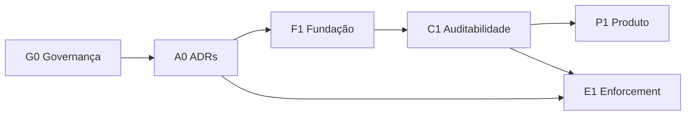

# Roadmap e gates do épico Oteru

Este arquivo é o índice local da [issue #1](https://github.com/luanmorenommaciel/oteru/issues/1). Ele organiza dependências e critérios de conclusão; a prioridade e o responsável oficiais continuam sendo os campos do GitHub.

## Marcos

| Marco | Objetivo | Entradas | Gate de saída |
| --- | --- | --- | --- |
| G0 — Governança | Definir autoridade, pods e processo decisório | #11, #13 | Captain, substituto, executores e revisores registrados |
| A0 — Arquitetura | Ratificar contratos de agnosticidade, durabilidade, PII e enforcement | #7, #8, #9, #10 | Quatro ADRs `accepted` ou bloqueios explícitos |
| F1 — Fundação de compliance | Implementar contratos e durabilidade | #5, #6, #22, #42 | Testes de contrato e falha reproduzíveis |
| C1 — Auditabilidade | Construir proveniência, trilha e pacote exportável | #72–#75 | Auditor reconstrói decisão sem dados implícitos |
| P1 — Produto e adoção | Expor sessões, cobertura e limites de interpretação | #50–#58 | UI distingue observado, inferido e sintético |
| E1 — Enforcement | Implantar Break Glass e possível gateway | #23, #108 | Revisão de segurança, shadow mode e autorização explícita |

## Caminho crítico

## Definição de pronto por marco

Um marco só termina quando:

1. cada issue possui executor, revisor, prioridade e dependências;
2. decisões estruturais estão em ADR aceito;
3. o comportamento possui evidência automatizada proporcional ao risco;
4. observabilidade, segurança, privacidade, migração e rollback foram avaliados;
5. documentação e comentários no GitHub apontam para as mesmas evidências;
6. limitações conhecidas permanecem visíveis e não são apresentadas como cobertura entregue.

## Estado em 02/11/2026

- G0 possui Captain definido; a estrutura dos pods está proposta e as vagas de executor/revisor continuam abertas na #13.
- A0 possui propostas locais; a ratificação depende das revisões e do aceite do Captain.
- O repositório já demonstra replay OTLP, Collector e consultas GenAI/MCP; isso é evidência de base, não conclusão dos ADRs.
- O código atual não implementa buffer durável de compliance, política runtime de PII ou bloqueio de chamadas.

